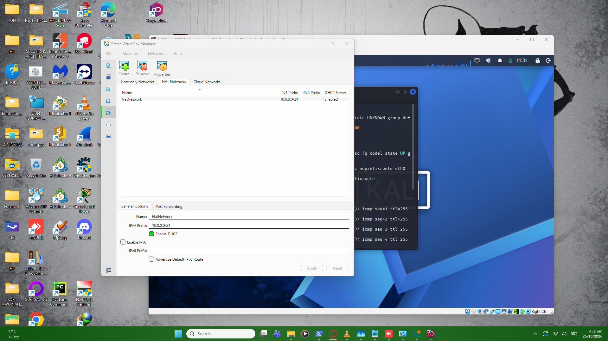
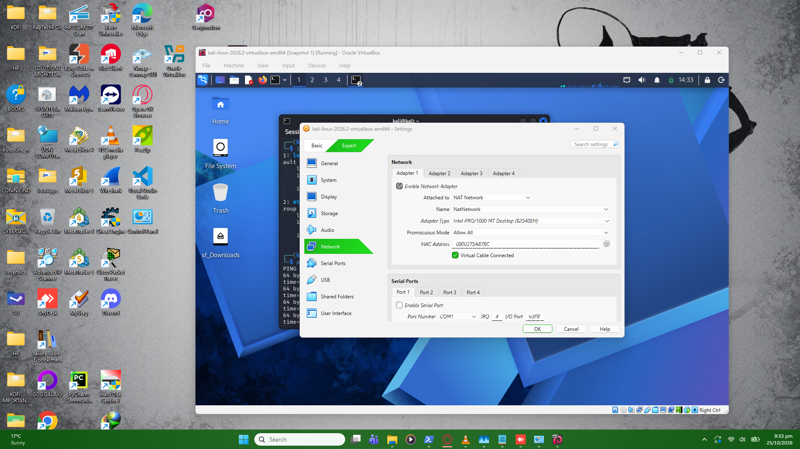
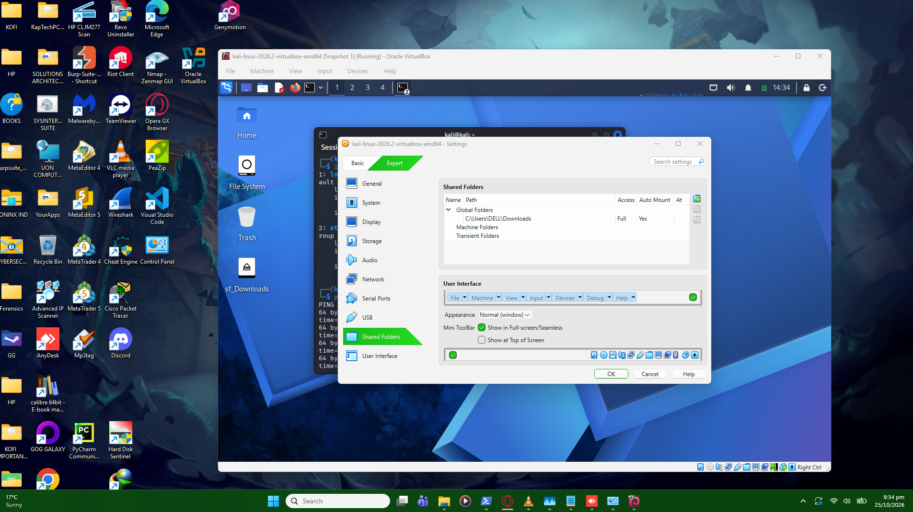
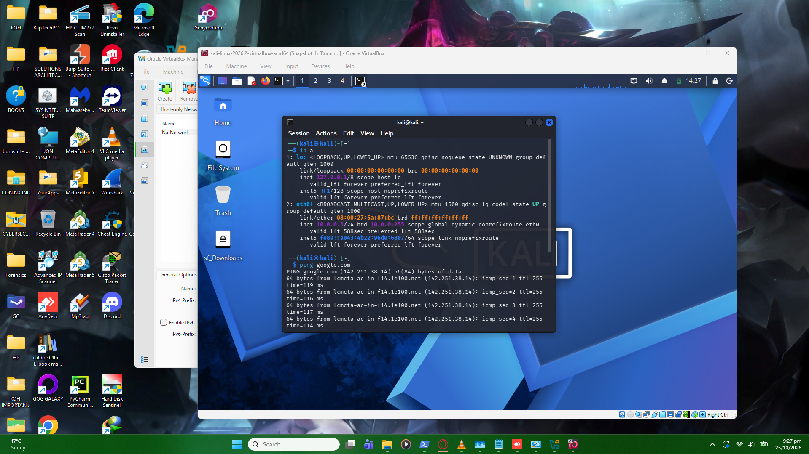

# Week 1 - Project Module 1: Lab Setup VirtualBox and Kali Linux

## Lab Specifications
* **Hypervisor:** VirtualBox
* **Attacker Machine:** Kali Linux 2026.2
* **Network:** NAT Network (10.0.0.0/24)
* **Kali IP:** 10.0.0.3/24
* **Features:** Bidirectional Clipboard, Drag & Drop, Shared `/downloads` folder.

## Setup Steps
1. Extracted the Kali `.7z` file and added the `.vbox` file to VirtualBox.
2. Created a NAT Network in VirtualBox (10.0.0.0/24).
3. Configured VM settings for Bidirectional Clipboard/Drag & Drop.
4. Added Shared Folder pointing to the host `/downloads` directory.
5. Set the static IP on Kali Linux using `nmcli`.
6. *(Optional)* Fixed the VirtualBox 7/Kali 2026 internet connectivity issue using the `ipv4.dad-timeout 0` command.

## Screenshots

### 1. NAT Network Setup

### 2. Kali VM Network Settings

### 3. Shared Folders Configuration

### 4. Kali Linux IP and Internet Test

